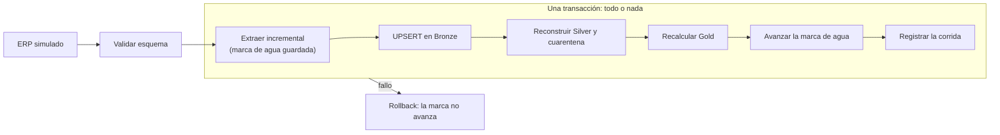

# La mini plataforma persistente

`src/agronova/plataforma.py` compone las funciones del paquete sobre un archivo SQLite para mostrar lo que las funciones sueltas no pueden: **estado entre corridas**. Es didáctica; no es código de producción (ver `adr/0006`).

## Qué tablas crea

| Tabla | Para qué |
|---|---|
| `brz_oc_linea` | Copia fiel del origen, con el lote que la cargó |
| `slv_oc_linea` y `slv_oc_linea_cuarentena` | Datos validados y rechazados con su motivo |
| `gld_otd_proveedor` | KPI por proveedor |
| `ctl_marca_agua` | Último valor procesado de la fuente |
| `ctl_corridas` | Registro de cada corrida: estado, filas, cuarentena, alertas y error |

## Qué demuestra la simulación

`python scripts/simular_plataforma.py --dias 6`

| Día | Qué ocurre en el ERP | Qué muestra |
|---|---|---|
| 1 | Carga inicial de 1,000 líneas | Carga incremental desde cero |
| 2 | 30 líneas se reciben tarde y llegan 20 nuevas | Una actualización y una inserción en la misma corrida; recibir tarde **no mejora** el OTD, pero sí cambia el OTD ingenuo |
| 3 | 5 recepciones con cantidad cero se corrigen | Una corrección tardía actualiza sin duplicar |
| 4 | El ERP agrega una columna | Un cambio compatible se avisa y se ignora |
| 5 | Se renombra una columna requerida | La carga **falla** y el estado no cambia |
| 6 | Se restaura la columna | La carga se recupera |

`python scripts/simular_plataforma.py --dias 1 --regla-defectuosa --reprocesar` reproduce el caso de «pipeline verde, dato incorrecto» y muestra cómo se corrige **reprocesando desde Bronze, sin volver a la fuente**.

## Qué está verificado y qué no

`[VERIFICADO EXPERIMENTALMENTE]` con datos sintéticos y SQLite (`tests/test_plataforma.py`): persistencia entre conexiones, marca de agua, actualización sin duplicar, atomicidad, idempotencia al reiniciar la marca, reproceso y cambios de esquema.

`[NO DEMOSTRADO]` Concurrencia, escala, un orquestador real, programación de corridas, monitoreo en una plataforma, seguridad y comportamiento en un motor productivo. El diagrama Mermaid de este documento **no se ha visto renderizado**.

## Ideas para ampliarla (ejercicios abiertos)

- Añade una tabla de linaje que registre de qué lote viene cada fila de Gold.
- Implementa una carga por particiones de fecha y su reproceso.
- Añade una alerta cuando cambie la distribución de unidades.
