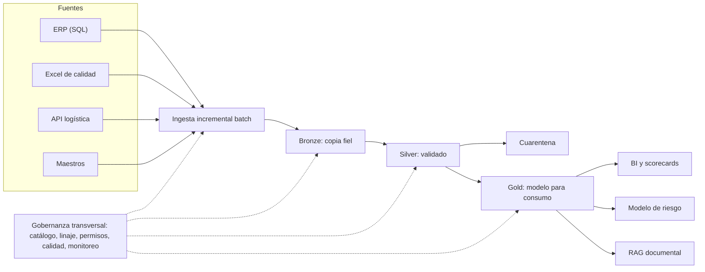
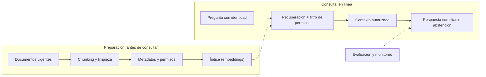
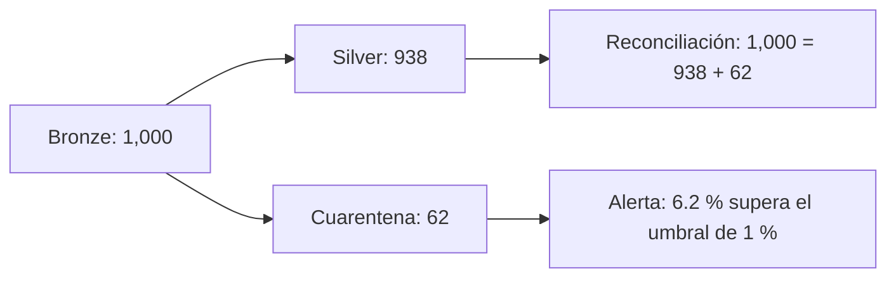

# Diagramas

GitHub renderiza estos bloques Mermaid directamente.

## 1. Plataforma con Medallion y gobernanza transversal

## 2. Flujo RAG: el filtro de permisos va antes del contexto

## 3. Pipeline verde, dato incorrecto: reconciliación y umbral

